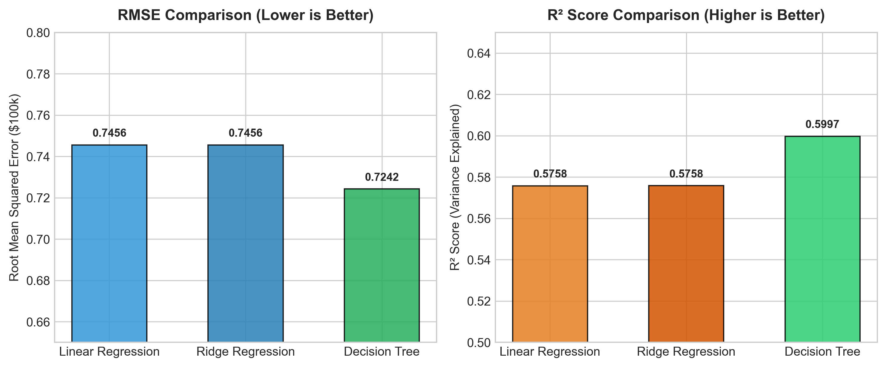
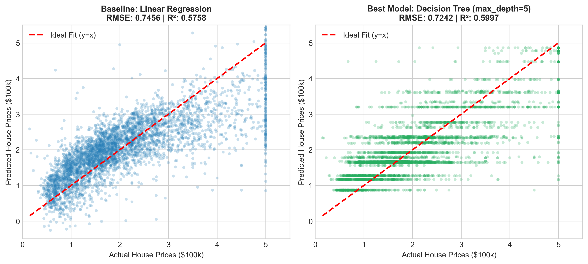
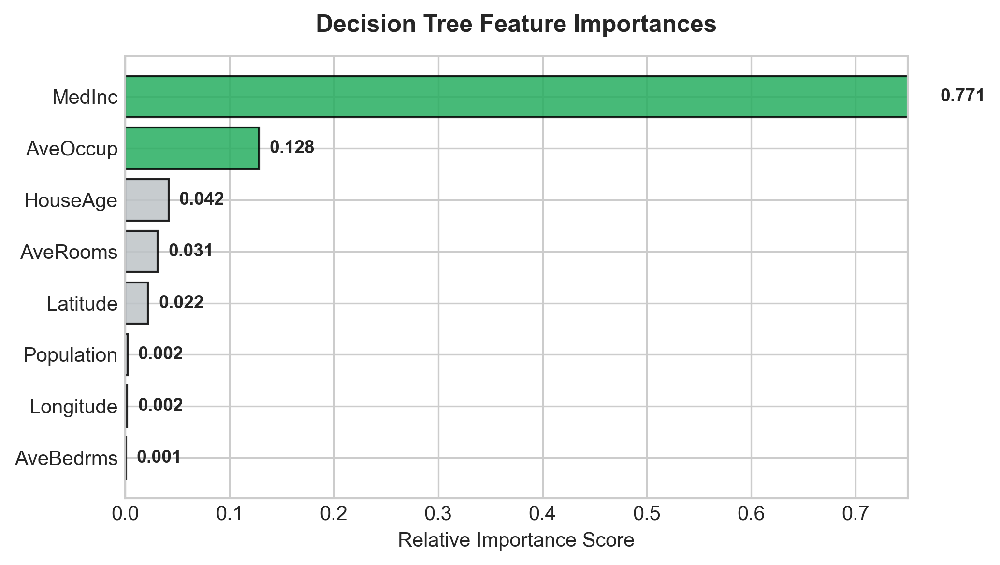
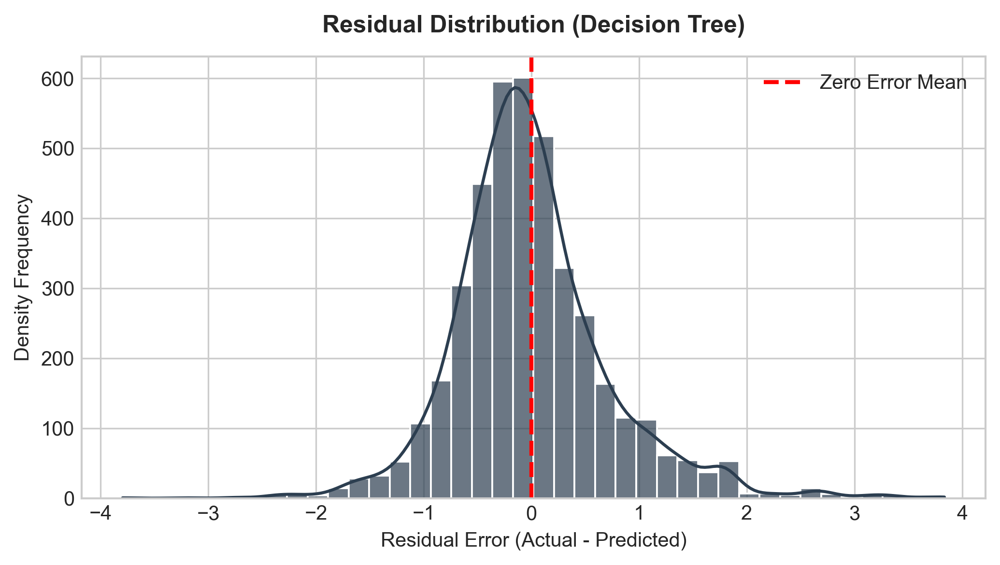

# 🏡 California Housing Price Prediction
### Feature Engineering, Model Optimization & Performance Comparison

[](https://www.python.org/downloads/)
[](https://scikit-learn.org/)
[](https://jupyter.org/)
[](https://opensource.org/licenses/MIT)

An end-to-end Machine Learning project developed as part of **MainCraft Technology AI & Machine Learning Task 2**. This repository demonstrates professional ML engineering practices including feature standardization, multi-algorithm training, empirical metric comparison ($R^2$, RMSE), diagnostic visualization, model serialization (`joblib`), and technical reporting.

---

## 📌 Project Overview & Objectives

In real-world machine learning systems:
- Raw models are rarely deployed without systematic data preprocessing.
- Features span diverse numerical ranges requiring normalization.
- Multiple algorithms with different inductive biases must be benchmarked against a baseline.
- Technical decisions and final model selection must be rigorously backed by measurable metrics and diagnostic visualizations.

### What Was Built:
- **Feature-Scaled Input Pipeline:** Zero-mean, unit-variance standardization via `StandardScaler`.
- **Multi-Model Benchmark:** Comparative evaluation of Ordinary Least Squares (OLS) Linear Regression, Regularized Ridge Regression, and Non-Linear Decision Tree Regressor.
- **Quantitative Evaluation:** Structured performance comparison using Root Mean Squared Error (RMSE) and Coefficient of Determination ($R^2$).
- **Visual Diagnostics:** Actual vs. Predicted regression plots, residual error distribution analysis, and feature importance rankings.
- **Production Artifacts:** Serialized best-performing model (`best_model.joblib`) and preprocessor (`scaler.joblib`) ready for low-latency inference.
- **Technical Summary Report:** Comprehensive 2-page publication-ready PDF report (`AI_ML_Task2_Report.pdf`).

---

## 📊 Dataset Specification

We utilize the **California Housing Dataset** derived from the 1990 U.S. Census:
- **Total Samples:** 20,640 census block groups
- **Predictor Features (8 continuous):**
  - `MedInc`: Median income in block group (in tens of thousands of dollars)
  - `HouseAge`: Median house age in block group
  - `AveRooms`: Average number of rooms per household
  - `AveBedrms`: Average number of bedrooms per household
  - `Population`: Block group population
  - `AveOccup`: Average number of household members
  - `Latitude` & `Longitude`: Geographical district coordinates
- **Target Variable (`HousePrice`):** Median house value in hundreds of thousands of dollars ($100,000s).

---

## 📈 Model Performance Benchmark

Models were trained on an 80% train split (16,512 samples) and evaluated on an unseen 20% test split (4,128 samples) with `random_state=42`:

| Model Algorithm | RMSE ($100k)<br/>*(Lower is Better)* | $R^2$ Score<br/>*(Higher is Better)* | Primary Inductive Bias & Architectural Notes |
| :--- | :---: | :---: | :--- |
| **Linear Regression** | `0.7456` | `0.5758` | Parametric baseline assuming additive linear relationships. |
| **Ridge Regression ($\alpha=1.0$)** | `0.7456` | `0.5758` | $L_2$ regularized linear model; near-identical due to high sample-to-feature ratio ($N \gg P$). |
| **Decision Tree (`max_depth=5`)** | **`0.7242`** | **`0.5997`** | **Best Performing Model:** Captures non-linear thresholds, geographical coordinates, and income boundaries. |

---

## 🖼️ Visual Diagnostic Highlights

### 1. Quantitative Performance Comparison
Comparison of Root Mean Squared Error and $R^2$ Score across the three algorithms:


### 2. Actual vs. Predicted Validation
Evaluating prediction alignment against the ideal diagonal line ($y = x$):


### 3. Feature Importance Analysis
Variance reduction contribution per feature in the Decision Tree Regressor:


### 4. Residual Error Distribution
Analyzing prediction errors $(y_{actual} - y_{pred})$ centered at zero:


---

## 🔬 Key Technical Insights

1. **Why Feature Scaling is Critical:**
   Features like `Population` range up to 35,682, whereas `MedInc` ranges between 0.49 and 15.0. Standardization ($z = \frac{x - \mu}{\sigma}$) ensures fair feature weighting, numerical stability during matrix inversion, and uncorrupted $L_2$ regularization penalties in Ridge Regression.
2. **Why Decision Tree Won:**
   Real estate valuations are fundamentally non-linear. Geographical coordinates and income brackets interact non-linearly (e.g. coastal proximity premiums), which a decision tree naturally captures through hierarchical orthogonal splits, improving $R^2$ to **0.5997** (approx. 4.2% increase in explained variance).
3. **Primary Valuation Driver:**
   `MedInc` (Median Income) accounts for **77.1%** of tree split importance, confirming that local economic earning power is the single strongest determinant of property value.
4. **OLS vs. Ridge Regression Equivalence:**
   Because sample size ($N = 16,512$) substantially exceeds feature dimensionality ($P = 8$), the OLS estimator exhibits minimal variance, making mild $L_2$ penalty ($\alpha=1.0$) negligible in performance difference.

---

## 📁 Repository Structure

```plaintext
california-housing-price-prediction/
├── AI_ML_Task2_Model_Comparison.ipynb   # Fully executed Jupyter Notebook with outputs
├── AI_ML_Task2_Report.pdf               # 2-Page Executive Technical Summary PDF
├── best_model.joblib                    # Serialized best-performing Decision Tree model
├── scaler.joblib                        # Serialized fitted StandardScaler transformer
├── figures/                             # Generated high-resolution diagnostic charts
│   ├── actual_vs_predicted.png
│   ├── feature_importance.png
│   ├── model_comparison.png
│   └── residual_distribution.png
├── generate_assets.py                   # Script to train models & output figures
├── generate_pdf_report.py               # Script compiling the 2-page ReportLab PDF
├── build_notebook.py                    # Script constructing notebook structure
├── execute_notebook.py                  # Script executing cells and capturing outputs
├── requirements.txt                     # Python dependencies
├── .gitignore                           # Git ignore rules
└── README.md                            # Comprehensive project documentation
```

---

## 🚀 Getting Started

### 1. Clone the Repository
```bash
git clone https://github.com/sumkumar8354-art/california-housing-price-prediction.git
cd california-housing-price-prediction
```

### 2. Set Up Virtual Environment & Dependencies
```bash
python -m venv venv
# On Windows:
venv\Scripts\activate
# On Linux/macOS:
source venv/bin/activate

pip install -r requirements.txt
```

### 3. Run the Jupyter Notebook
```bash
jupyter notebook AI_ML_Task2_Model_Comparison.ipynb
```

### 4. Perform Production Inference with Serialized Model
```python
import joblib
import pandas as pd

# Load saved pipeline artifacts
scaler = joblib.load("scaler.joblib")
model = joblib.load("best_model.joblib")

# Example sample data (MedInc, HouseAge, AveRooms, AveBedrms, Population, AveOccup, Lat, Long)
sample_house = pd.DataFrame([{
    "MedInc": 8.3252,
    "HouseAge": 41.0,
    "AveRooms": 6.9841,
    "AveBedrms": 1.0238,
    "Population": 322.0,
    "AveOccup": 2.5556,
    "Latitude": 37.88,
    "Longitude": -122.23
}])

# Predict
scaled_sample = scaler.transform(sample_house)
predicted_price = model.predict(scaled_sample)
print(f"Predicted House Price: ${predicted_price[0] * 100000:,.2f}")
```

---

## 📜 Deliverables Verification

- [x] **Jupyter Notebook:** `AI_ML_Task2_Model_Comparison.ipynb`
- [x] **Model Comparison Table:** Included in notebook, report, and README
- [x] **1–2 Page PDF Report:** `AI_ML_Task2_Report.pdf`
- [x] **Model Serialization (`joblib`):** `best_model.joblib` and `scaler.joblib`
- [x] **Advanced Visualizations:** Feature importance, residual distribution, and actual vs predicted plots

---

## 👨‍💻 Author & Acknowledgments

- **Intern / Developer:** sumkumar8354-art
- **Organization:** [MainCraft Technology](https://www.maincrafts.com)
- **Role:** AI & Machine Learning Engineering Intern
